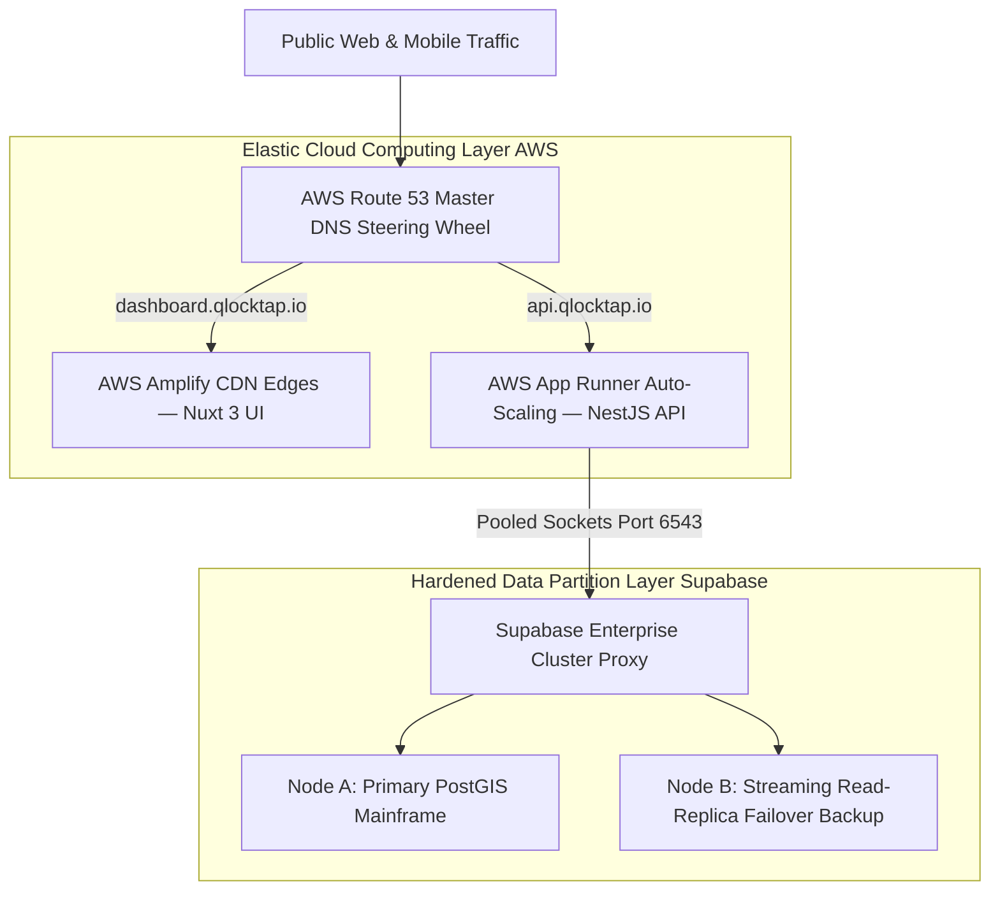
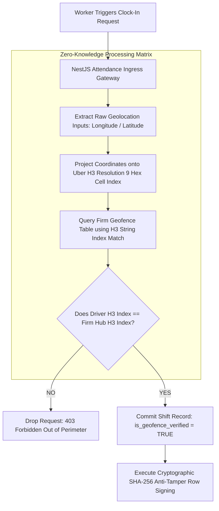
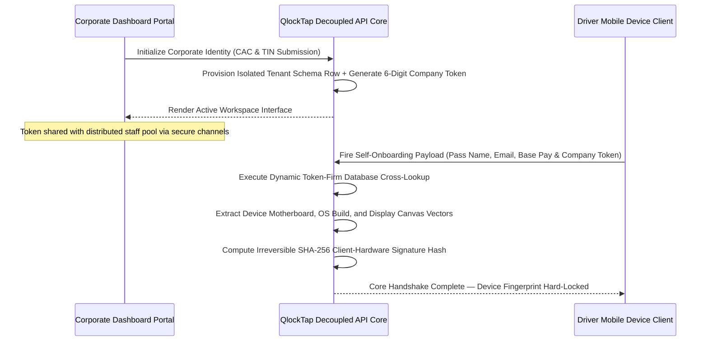
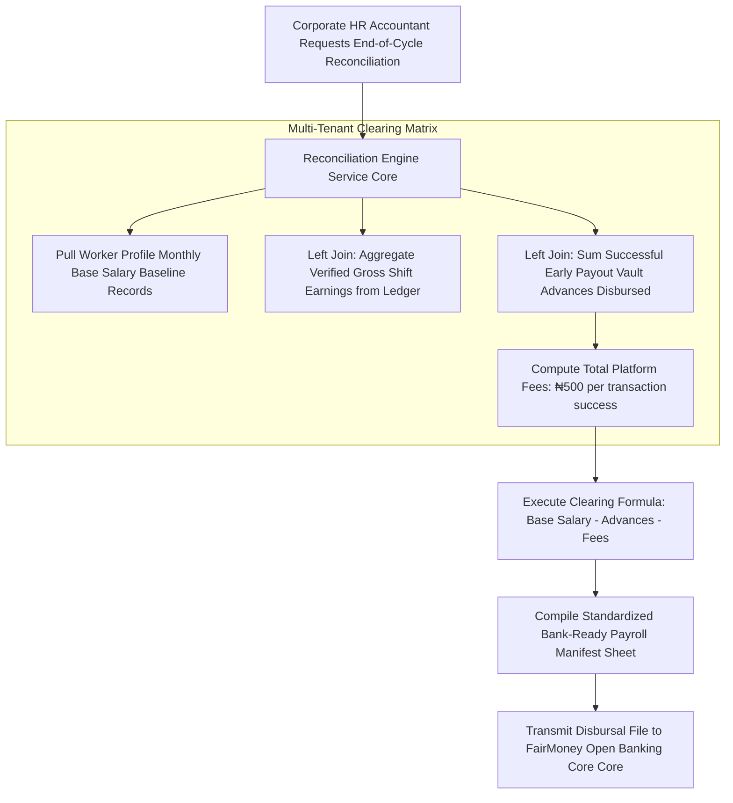

# QlockTap Core Engine — Enterprise Multi-Tenant EWA Architecture Specification

Welcome to the primary architectural specification repository for the **QlockTap Core Engine**. This public repository serves as an open-access blueprint mapping out the structural innovations, multi-tenant isolation loops, and advanced cybersecurity defensive controls engineered into the platform's decoupled backend mainframe.

---

## System Core Architecture & Design Patterns

The platform is designed following the **Hexagonal Architecture (Ports and Adapters) Pattern**. This architectural separation guarantees that core domain business calculations (such as dynamic earned wage cap pooling and financial clearing logic) remain completely isolated from volatile third-party network APIs, consumer client variations, and database ingestion channels.

### 1. Zero-Knowledge Spatial Ingestion & Presence Verification
To enforce strict worker tracking data anonymity and eliminate legal data-logging liabilities under the **Nigeria Data Protection Act (NDPA)** and global **GDPR** frameworks, raw telemetry vectors are never committed to permanent storage disk. Instead, incoming coordinates are instantly projected onto a discrete global hexagonal grid using **Uber's H3 Spatial Index Engine at Resolution 9**, resolving tracking boundaries down to an un-alterable binary `true/false` pass token inside the ledger.

### 2. Symmetrical B2B Onboarding Handshake Flow
SME enterprises register natively via authenticated credentials pools, spawning a unique, permanent 6-digit corporate token string reference. Workers use this single code block to self-onboard on their independent mobile devices. The backend intercepts the ingestion packet, captures mobile hardware configuration properties, and hashes them into an uncopyable SHA-256 fingerprint baseline rule to neutralize proxy clock-in and identity theft fraud loops.

### 3. Asymmetric Monthly Payroll Reconciliation & Clearing
At the close of an active billing cycle, the core analytics engine triggers high-performance relational left-joins across the schema partitions to compute dynamic salary deductions, platform administrative processing fees, and output bank-ready batch settlement manifests. This converts complex double-entry financial clearing math into clean, actionable, enterprise-standard data manifests.

---

## Applied Cybersecurity & Hardening Controls

Drawing directly from international enterprise information security methodologies, the core platform codebase is hardened against advanced security threat vectors:
* **Authenticated Column-Level Encryption:** Sensitive banking strings and routing fields are fully scrambled prior to storage using an authenticated **AES-256-GCM cipher pattern** holding automated Initialization Vectors (IV) and Galois authentication tags to completely neutralize direct database injection or internal breaching threats.
* **Perimeter Access Checkpoints:** API endpoints are protected via an asymmetric **JWT Bearer Token Guard** tracking custom metadata decorators to enforce strict Role-Based Access Control (**RBAC**), completely firewalling corporate data layers from field worker tokens.
* **Database Connection Pooling:** Backend container nodes map asynchronous transactions natively using **PgBouncer protocols over encrypted Port 6543** to completely eliminate connection socket starvation anomalies under massive spikes in concurrent traffic.

---
